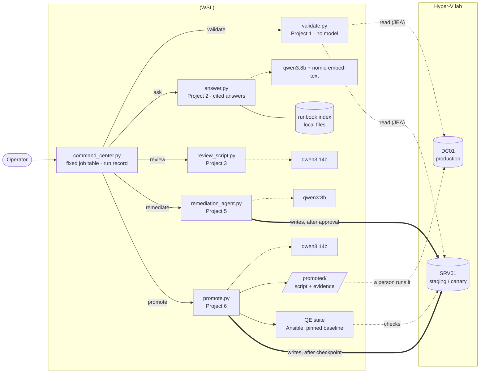
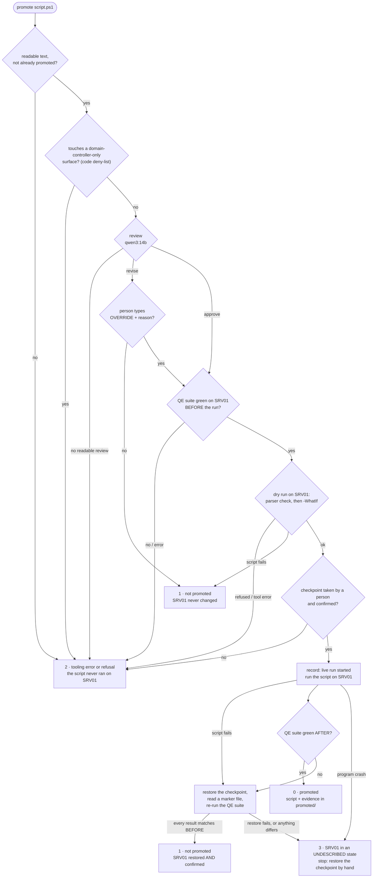

# The Command Center

One command-line entry point that runs five small tools (four of them use a local AI model)
against a two-server Windows lab. It decides **nothing** with a model that it can decide with code: the operator names the job,
a fixed table picks the program, and every model in the system holds its role because of a
measurement that is written down (for the reviewer, a head-to-head against two other models, the
full multi-model chain, and a lint tool). The only machine it changes is a staging server, and every change there is checked afterward by a
separate reader: the QE suite for `promote`, a second read-only account for `remediate`.

Built as the final project of a self-directed course in agentic AI engineering, on personal
hardware against a personal lab. No employer systems, data, networks or credentials were used.

> **In one sentence:** you hand it a PowerShell script; a local model reviews it, the staging
> server is checked healthy, the script is dry-run, a checkpoint is taken, the script runs for
> real, and the server is checked again. If it still passes, the script and its evidence are filed
> for a person to run in production; if not, the server is rolled back and the system *proves* the
> rollback worked before it says so.

---

## The lab it runs on

| Machine | Role | What the system may do to it |
|---|---|---|
| **<host>** | Windows 11 desktop (RTX 5080, 16 GB). Runs the Command Center in WSL (Linux on Windows), the local models through Ollama 0.40.8, and Hyper-V | — (it is the host) |
| **DC01** | Domain controller for the lab domain `corp.lab`: the lab's **production** | **Read only.** Never written by the system (see the note below on what enforces that) |
| **SRV01** | Member server: the lab's **staging / canary** server (a canary is the machine that takes a change first, so breakage shows up there) | The **only** machine the system writes to, and only through two gated jobs: `promote` refuses to run the script until a checkpoint is confirmed; `remediate`'s playbook has a person take one first |

Both servers are Hyper-V virtual machines. A **checkpoint** is a Hyper-V snapshot that SRV01 can be
rolled back to.

**The QE suite** (QE: quality engineering) is a separate, earlier project: Ansible playbooks that check a server (it has a suite
for each of DC01 and SRV01; `promote` runs only SRV01's) against a pinned baseline (services, time sync, event logs, audit policy and more) and exit 0 when everything
matches. On SRV01 it reports 48 results: 30 checks, plus 18 entries saying which groups of checks
ran to completion (the suite stops at the first failing group). The Command Center uses that
suite as-is to decide whether a change broke anything. It reaches the servers over WinRM with
the QE project's own Ansible inventory and vault.

**Why rehearse on a member server when production is a domain controller?** Most server
configuration (services, event logs, audit policy, registry) behaves the same on both, and SRV01
can be rolled back without touching the domain. What a member server *can't* rehearse (Active
Directory, the DC database, the DNS server role) is refused outright by a deny-list before review.
That is a real limit: a script that passes on SRV01 has been rehearsed on a member server, not on
a DC.

**What keeps DC01 read-only is code, not credentials.** `validate` uses an account that cannot
write anywhere (Project 1). But the QE suite's Ansible account is an administrator on both servers,
and `promote` reaches SRV01 with it. What stops it touching DC01 is the run playbook: it targets
only `srv01`, asserts that, and is invoked with `--limit srv01`. A bug there could reach DC01. No
separate account makes it impossible.

## How it fits together



Dotted lines read, thick lines write. No job is built to write to DC01 (what enforces that is code,
as the note above says, not a missing credential): the last step to production is a person reading the evidence in `promoted/` and running the script themselves.

**Where is Project 4?** It is the evaluation harness, not a job: it runs the golden test suites
that every other project is scored by (including this one's), and CI runs it on every push.

## The jobs

`python src/command_center.py <job> [arguments]`. `--list` prints this table. A job name that is
not in it is refused before anything runs.

| Job | Program | What it does | Model | Can change a machine? |
|---|---|---|---|---|
| `validate` | Project 1 | Reads a server's audit policy through a locked-down remote endpoint (JEA: the account can call only a fixed list of functions) and checks it against what you say it should be: `--expect "Logon=Success and Failure"` | none | no |
| `ask` | Project 2 | Answers a question from a local index of runbooks and Windows Server docs, citing the file each sentence came from, or refuses and says why | qwen3:8b, nomic-embed-text | no |
| `review` | Project 3 | Reviews one PowerShell script against a written rubric; returns structured findings with line numbers | qwen3:14b | no |
| `remediate` | Project 5 | Code compares SRV01 against its baseline to find drift; the model proposes **one** fix, **shows it to a person and waits for yes**, applies it with a write account, re-reads the setting with a *separate* read-only account (the verifier), and rolls back if the verifier disagrees, then verifies the rollback the same way. Its playbook (not its code) has a person take a checkpoint first, for the case where rollback itself fails | qwen3:8b | **yes**: SRV01 |
| `promote` | Project 6 | Takes a script through review, dry run, checkpoint, live run and the QE suite on SRV01 (the flow is below) | qwen3:14b | **yes**: SRV01 |

**Why a table and not a model?** The operator already knows which job they want. A model reading
a sentence and choosing a route would add a way to fail and no ability the table lacks, and it
would sit in front of the write path. The rule throughout: *the model proposes, the code decides.*
Where a model's verdict does gate something (the reviewer in `promote`), it can only **stop** a
run, never cause a write: code and the QE suite decide every step that changes SRV01.

**Every run leaves a record**: one JSON file per run in `evals/runs/`. It holds the job, the
command, the exit code, and the exact build (digest) of each model used plus the Ollama version.
The record is written *before* the job starts and again when it ends, so a run that dies midway
still shows that it began. `promote` and `remediate` also keep their own, more detailed records
(the steps reached, the checkpoint name), which the Command Center's record points to. If a model's digest can't be read, the job doesn't run ("no digest, no run").

## Which model does what, and the evidence

Each role went to a model because of a measurement in an earlier project. Only the reviewer role
was a head-to-head comparison; the proposer, answerer and embedder were each one model measured
against its test suite and kept because it passed. The sets are small and hand-built, so every
number below carries its set size. With sets this small, rates swing: the held-out set had only
4 clean controls.

| Role | Model | Measured | On what |
|---|---|---|---|
| Script reviewer (`review`, `promote`) | **qwen3:14b** | Caught **17/24** planted defects (development set: 8 scripts) and **10/12** (held-out set: 4 scripts, read once). Re-measured on Ollama 0.40.8: still 17/24. About 3,400 output tokens per defect caught (cost is measured in output tokens: everything runs locally, so no money is spent per call) | 12 PowerShell scripts with 3 planted defects each, plus clean copies of the same scripts as controls |
| …its known cost | | **False alarms on 5/8** clean controls (development, 0.40.8); 1/4 held-out | the same clean controls |
| Fix proposer (`remediate`) | **qwen3:8b** | Proposed the right fix **11/11** times on SRV01 | drift planted by hand: registry, service, audit policy |
| Answerer (`ask`) | **qwen3:8b** | **24/27** on the answer suite, measured on Ollama 0.40.4 (not re-run since); every answer traced to a source chunk | 27 questions with known answers, including ones that should be refused |
| Retrieval (`ask`) | **nomic-embed-text** | **16/20** on the retrieval suite on Ollama 0.40.8 (four failures named and kept) | 20 questions with a known right source |
| Hermes (hermes3:8b) | **no role** | Tested as a reviewer and dropped: **5/24** development, **5/12** held-out, the weakest model tested | the same 36 planted defects |
| Frontier model (a paid API) | **no role, a closed slot** | Not measured. The slot exists in the design, with conditions to open it: an allow-list of what may be sent, the key from the environment, a spend cap set first, a written decision, and a fresh test set | — |

For comparison, a lint tool (PSScriptAnalyzer, no model) caught 6/24 with **0/8** false alarms.
The rubric the reviewer scores against is `projects/03-script-review-pipeline/rubric.md`. A review
returns findings marked **blocking** (the verdict is *revise*) or **advisory** (noted, verdict can
still be *approve*).

**What the false-alarm rate means in practice:** the reviewer blocked 5 of 8 clean development
scripts (1 of 4 held-out), and in the real runs it blocked every script it reviewed,
clean or not, citing a defect that wasn't there. In
`promote`, a block stops the run (the safe direction) and shows the findings. A person may then type
`OVERRIDE` plus a reason, and the run continues. The override and its reason go into the run record
and into the evidence filed with the script. An override skips the review and nothing else (CI has
a case where an overridden bad script reaches the live run and the QE suite still catches it and
restores): QE
before, the dry run, the checkpoint and QE after all still run, and the QE suite still decides. It
cannot override a *missing* review (exit 2). The standalone `review` job has no override: it only
reports. In practice, then, an override is routine and the review is closer to a second opinion shown to a
person than to a gate. Choosing a better reviewer is a named follow-on, not part of this project.

## The promotion flow

`python src/command_center.py promote path/to/script.ps1`

Each step's failure ends the run, with the exit code shown on the arrow.



Points a reader tends to ask about:

- **"Promoted" doesn't mean deployed.** It means *cleared with evidence for a person to run in
  production*: the script, its review, any override, the QE results before and after, and the run
  record, filed under `promoted/<name>-<hash>/` (the first 8 characters of the script's SHA-256, so
  the same script can't be promoted twice). DC01 is never touched.
- **The QE suite must be green before the run**, or the run is refused. A canary that's already
  failing can't judge a script, and the before report is what "restored" gets compared against.
- **The checkpoint is taken and restored by a person** at an administrator prompt on the host; the
  Command Center account has no Hyper-V rights. The flow pauses, prints the exact command, and the
  person pastes the command's output back. The paste must name this run's checkpoint and show it
  is a *Standard* checkpoint (restoring one resumes the VM where it was, without a reboot), or the
  run stops with exit 2.
- **A restore isn't trusted until it's checked.** The program writes a marker file on SRV01 with
  one value just before the person takes the checkpoint, and a second value once the checkpoint is
  confirmed (still before the live run). Reading the first value back after a restore proves the
  checkpoint really was applied. Then the QE suite runs again, and every result must equal the before report.
  The program never takes its own word that the restore worked.
- **The deny-list is a floor, not a classifier.** It refuses scripts that name domain-controller-only
  modules and commands (Active Directory, DNS server, NTDS…), which a member server can't rehearse
  faithfully. Passing it means "not known to be DC-only", never "safe". A deny-list refusal
  cannot be overridden.
- **The dry run refuses what `-WhatIf` can't contain.** First PowerShell's own parser lists every
  command in the script without running it. Refused: native executables, dynamic invocation, .NET static calls,
  redirection, scripts that reach another machine (`-ComputerName`, `Invoke-Command`), scripts that don't declare `-WhatIf` support
  (`[CmdletBinding(SupportsShouldProcess)]`), and state-changing cmdlets called without it. Then
  the script runs once with `-WhatIf`. So only scripts written that way can be promoted at all.
- **Two kinds of checkpoint.** `promote` takes a *run checkpoint* for each run and restores it only
  when the run fails; after an exit 0 it leaves SRV01 changed, because a passing canary is the
  point. Separately, a person takes a *session checkpoint* at the start of a session of runs, and
  restores it at the end, so the lab goes back to its baseline between sessions. (Within a session,
  a promoted change stays, so the next run's QE-before sees it. That only works because the clean
  sample changes something QE doesn't pin, the Application log size.)
- **The marker value names the run's checkpoint** (`<checkpoint-name>:pre`), and each run's
  checkpoint name is unique, so reading it back proves *this* run's checkpoint was restored.
- **It is interactive by design.** The vault password, the checkpoint paste, any `OVERRIDE` and
  `remediate`'s yes are typed by a person at the terminal. Neither job runs unattended.

## Every exit code, for every job

The Command Center passes a job's exit code through **unchanged** whenever the job exits on its
own, so it means what that program defines. It substitutes a code only when it never started the
job, or when the job was killed and so returned no code (first row). The run record's `state` and `child_returncode` say whether a 2 came from the job or from
the Command Center itself.

| Job | 0 | 1 | 2 | 3 |
|---|---|---|---|---|
| *any job, from the Command Center itself* | — | — | **the job never ran**: unknown job, bad arguments, run record not writable, a model digest unreadable, or the program couldn't start. Also used when a **read-only** job is killed mid-run (Ctrl+C): it did run, but it can't have changed anything | a job that **can change a machine** (`remediate`, `promote`) was killed mid-run. The Command Center can't see how far it got, so it reports 3 even if the job had not yet started its live run; the job's own record says whether it had |
| `validate` | read; every `--expect` matched (or none was given) | read; at least one `--expect` didn't match, and each mismatch is printed with what the server said | no answer: no session, the endpoint's list of functions changed from the reviewed list (it is checked before every call), the call failed, or an `--expect` named something the server doesn't report | — |
| `ask` | the program finished: **either** an answer with citations **or** a named refusal (no relevant sources / sources don't answer it / citations failed twice). The printed `outcome` says which | not a verdict: Python's code for an unhandled error, such as a reply that isn't valid JSON. A traceback is printed | the model is unreachable, or the question plus sources didn't fit the context budget | — |
| `review` | approve: no blocking finding (advice, not "safe": the reviewer misses about 7 in 24) | revise: at least one blocking finding, printed with its lines, category and fix | no review: file unreadable or empty, model unreachable, or the reply broke the schema. A review that can't be read approves nothing | — |
| `remediate` | the fix held (verified by a separate reader), or there was nothing to fix | nothing the agent did stands, and SRV01 is in a described state: rolled back, refused, or the person said no | tooling or configuration error; **nothing was applied** | **SRV01 in an undescribed state** (rollback failed): restore from the checkpoint |
| `promote` | promoted: script + evidence in `promoted/` | not promoted; SRV01 either never changed or was **restored and confirmed** | tooling error or refusal **before the live run**: the script never ran on SRV01 (a checkpoint may exist, and the flow's own working folder `C:\ProgramData\P06\`, holding the marker file and a copy of the script, may have been written; neither is a change the script made) | **SRV01 in an undescribed state**: restore failed or didn't match, a crash after the live run began, or `promote` killed mid-run (see the first row). **Stop; restore the run's checkpoint by hand; don't re-run until SRV01 is confirmed (below)** |

**A crash is a clean code.** `promote` and `remediate` catch every unexpected error and map it by
their record (2 before the live run / before anything was applied, 3 after). `validate`, `review`
and `ask` only read, so a crash there can only mean *no answer*: **2**, with `CRASH` and the error on
stderr (`src/entry.py`, tested by forcing a crash through each real file). Until 2026-10-23 they exited
Python's default 1, which read as a *mismatch* or a *revise*; a cold read of this page found it. One
limit remains: a failure while the program is still *importing* (a missing package) still exits 1.

The rule behind codes 2 and 3: *"maybe half-changed" must never read as "nothing changed."* Once
`promote` has written "live run started" to its record, 2 is no longer a possible answer, only
0, 1 or 3. The record decides which, not a guess.

**After an exit 3,** restore the run's checkpoint by hand (its name is in `promote`'s record; if the
record shows no checkpoint was confirmed, the script never ran and there is nothing to restore), then
confirm SRV01 the same way the flow would: the QE suite green and `python tools/p06_bench_check.py`
reporting ALL HOLD. Only then run `promote` again.

## Evidence that it works

- **On every push (CI, no machines, no models):** the repo's check run (`tests/run_checks.py --home ci`, 54
  check files across every project) passes 54/54. One of them runs this project's `command-center`
  suite: 28 fixed cases against a fake SRV01, fake checkpoint and fake QE suite. They cover each fork of the flow, every
  exit code, the override, and an override that tries to skip the QE suite. A case passes only if
  both the exit code and the run record match.
- **On the real lab** (`playbooks/p06-promote-on-srv01.md`, evidence in
  `evidence/build-step-05-promote-on-srv01.md`):
  - **Run A, a clean script, exit 0.** It set the Application log to 32 MB. The reviewer blocked it
    for a defect that wasn't there (it reported a slash on a line that has none). A person overrode
    with that reason, QE passed before and after, and the script was promoted.
  - **Run B, a bad script, exit 0: a false promotion.** It set the System log to 64 MB against a
    20 MB baseline. The reviewer blocked it with another invented defect and was overridden, as
    in Run A, because the point of the run was to test QE. The QE check read the size one way (`Get-WinEvent`); the script wrote it another
    way (the classic registry value). The check couldn't see the change. Afterwards the false
    promotion was moved out of `promoted/` into the evidence folder, and the session checkpoint was
    restored, taking SRV01 back to its baseline. The fix went into the QE
    project itself (it now reads the size three ways and records before it asserts), not around it
    in this one.
  - **Run B2, the same bad script, after the QE fix, exit 1: restored and confirmed.** QE after
    failed on the System log. (The reviewer blocked it again and was overridden again. B2 could run because B's entry had been moved out of `promoted/` and
    SRV01 was back at its baseline, so QE before was green.) The checkpoint was restored, the marker read back its old value, and the QE suite matched
    the before report on all 48 results.

Run B is kept in the evidence on purpose: it's the one run where the system said yes and was wrong.

**Watch it (81 s):** [`recording/p06-promote-recording.mp4`](recording/p06-promote-recording.mp4).
It's a fresh real run of the bad script on the evening of 2026-10-23 (the lab's local time; the run record's UTC stamps read 10-24), the same flow as B2: the reviewer blocks
it on an invented defect, a person overrides, a person takes the checkpoint, QE after goes red,
SRV01 is restored, and the restore is confirmed against the before report. Exit 1. It uses hard cuts
at real speed, and every frame of the run is stamped with its time in the 12-minute take. The run record is in
[`evidence/recording-run/`](evidence/recording-run/). The host machine's name is masked as `<host>`. The
video *shows* the evidence; it isn't the evidence (ADR 0044).

## The original design, and what measurement changed

The first plan (2026-09-05) was an org chart: a small model drafts, a second model (Hermes)
peer-reviews, a bigger model reviews, a frontier model signs off, then the change is promoted. Project 3
built and measured the local half of that chain on 36 planted defects. The scripts already held
the defects, so the drafter's job in the test was to *revise* what the critic flagged. Escalation
to the bigger model happens only for what the first critic blocks, so anything Hermes approved
shipped as it was:

| Arm (development set, 24 defects) | Caught | False alarms (8 clean) | Output tokens per catch |
|---|---|---|---|
| The chain: Hermes critique → up to 2 revisions by qwen3:8b → escalate to qwen3:14b | **5/24** stopped; **17/24 shipped broken**, every one waved through by the first reviewer; 2 ended in errors; revisions fixed 0 | 1/8 | ~17,300 |
| qwen3:14b alone | **17/24** | 6/8 (0.40.4) · 5/8 (0.40.8) | ~3,400 |
| qwen3:8b alone (the drafter) | 11/24 | 6/8 | ~5,700 |
| Hermes alone (the critic) | 5/24 | 3/8 | ~1,400 |
| PSScriptAnalyzer (no model) | 6/24 | 0/8 | 0 |

On the held-out set (read once): qwen3:14b 10/12, qwen3:8b 9/12, Hermes 5/12, the linter 2/12; the
chain shipped 7/12 broken. **One model alone beat the chain at about a fifth of the cost per
catch** (output tokens), so the Command Center was built around that measured result. The
trade-off is real: the chain raised the fewest false alarms of any model arm (1/8). Hermes
flags clean scripts (3/8 on its own), but in the chain the reviser rewrote the flagged ones and
Hermes approved the rewrites, so only 1 reached a person. Hand inspection found both rewritten
clean scripts broken, which no score caught. The Command Center accepts more
false alarms (and a person's override) in exchange for catching three times as many defects. The org chart is kept as the
design that was tested and changed.

## What is not claimed

- **Not "routing by cost" per request.** Roles were chosen **once**, from measured catch rate and
  cost per catch. Nothing picks a model at run time.
- **Not "best model available".** Only "best of what was measured locally". No frontier model was
  ever measured; that slot is closed.
- **Not "review makes a script safe".** The reviewer misses about 7 in 24 planted defects and blocks
  most clean scripts. The QE suite on a checkpointed canary is the gate.
- **Not "the QE suite sees everything".** Run B showed it can be blind to a change, and fixing one
  blind spot doesn't prove there are no others. It sees what its baseline pins. A script that changes
  something the baseline doesn't pin (Run A's Application log) passes QE by default: "promoted"
  then means *it broke nothing QE checks*, not *it did the right thing*. The person reading the
  evidence judges that.
- **Not "the deny-list identifies DC-only scripts".** It refuses the names it lists.
- **Not a deployment pipeline.** There is no tooling for the final step: a person runs the promoted
  script on DC01 by their own change process, and nothing checks that what they ran matches the
  promoted hash.
- **Not credential-isolated from DC01.** See *The lab it runs on*: the boundary is code.
- **Not able to promote any script.** Only scripts that declare `-WhatIf` support and call no
  native executables or other machines get past the dry run.
- **Not production-tested.** One lab, two VMs, a handful of real runs. The numbers come from small,
  hand-built sets (12 scripts, 27 questions, 20 retrieval questions, 11 fixes).
- **Not repeatable byte for byte across model-server versions.** On 2026-10-21 the same model
  digest gave the same verdict in different words on two Ollama versions. Records store the digest
  *and* the server version for that reason.

## Running it

Needs: WSL with Python 3 and the repo's `requirements.txt` in a venv; Ollama on Windows (one
`ollama serve`, started with `OLLAMA_HOST=0.0.0.0` so WSL can reach it) with `qwen3:8b`,
`qwen3:14b` and `nomic-embed-text`. qwen3:14b was measured on a 16 GB GPU. Commands run from the
repo root. Jobs that touch servers need the lab: DC01 and
SRV01 on Hyper-V, the QE project checked out, and its Ansible vault password.

```bash
python tests/run_checks.py --home ci                     # what CI runs; no models or servers
                                                         # (--home bench adds the model checks)
python src/command_center.py --list                       # the job table
python src/command_center.py review projects/06-command-center/samples/promote-clean-applog.ps1
python src/command_center.py validate --server srv01 --expect "Logon=Success and Failure"
python src/command_center.py ask "print jobs are piling up and nothing comes out"
# promote writes to SRV01: run it only from the playbook below
```

Run the real `promote` from the playbook (`playbooks/p06-promote-on-srv01.md`). It lists the
preconditions, where each command runs (WSL; an administrator PowerShell on the host for Hyper-V;
a separate PowerShell window left running `ollama serve`) and the expected exit codes. `validate`
also needs the JEA endpoint from Project 1 registered on the server; `ask` needs the runbook
index built once (`python -c "import sys; sys.path.insert(0,'src'); import retrieval; retrieval.build_index()"`,
which writes `data/index.json`; it is not committed).

## Words used here

| Word | Meaning here |
|---|---|
| **ADR** | Architecture decision record: a short file in `docs/adr/` with the options, the choice and why. This project's are 0040–0046 (what it builds, the job table, the promotion flow, models per role, exit codes, what is published, the model-server version) |
| **Ansible / vault** | The automation tool the QE suite is written in; its *vault* is an encrypted file holding the lab's passwords, opened with one password asked at the start of a run |
| **WinRM** | Windows' remote-management protocol; everything here reaches the servers over it |
| **Canary** | The server that takes a change first (SRV01), so damage shows there and not in production |
| **Checkpoint / restore** | A Hyper-V snapshot of SRV01, and rolling the VM back to it. *Run* checkpoint: one per `promote` run; *session* checkpoint: one per session of runs |
| **Digest** | The hash of the exact model build. A model's name can point to different builds; the digest can't |
| **Drift** | A setting that no longer matches the server's baseline (`remediate`), or an endpoint whose function list no longer matches the reviewed one (`validate`) |
| **Dry run / `-WhatIf`** | PowerShell's "say what you would do, don't do it" mode |
| **JEA** | Just Enough Administration: a Windows remote endpoint that lets an account call only a fixed list of functions |
| **Bench** | The desktop (<host>) with Ollama running: where model checks and real runs happen, as opposed to CI. `tools/p06_bench_check.py` checks SRV01 is ready for `promote` (marker readable, dry run working, QE green) and prints ALL HOLD when every check passes |
| **Planted defect** | A bug inserted on purpose at a known line, so a reviewer's catch can be scored by code |
| **Development / held-out set** | The test data split in two: *development* is used while building (and may be designed against); *held-out* is kept unseen until one final reading, so that result isn't tuned to it |
| **Golden suite** | A fixed file of test cases with known right answers, scored by Project 4's harness |
| **Green / red** | The QE suite (or a check run) passing / failing |
| **Schema** | The fixed JSON shape a model's reply must have (for a review: findings with lines, category, severity, why, fix). A reply that doesn't fit is rejected, not guessed at |
| **Context budget** | The most text the model is sent at once; if a question and its sources don't fit, `ask` stops with exit 2 rather than cut sources |
| **QE suite** | The earlier project's Ansible checks against each server's pinned baseline |
| **Run record** | The JSON file every job writes to `evals/runs/` |

## What's not in this slice

This repository is a curated slice of a private build repo: the working system, its tests and
the inputs they read, and the evidence for the promotion flow. Some things it cites are not here:

- **ADRs 0001–0039.** The decisions of Projects 1–5. Only Project 6's (0040–0046) are published;
  a citation like "ADR 0026" in code or a README points to the private record.
- **Commit hashes** (`d3df30c`, PR #33, the held-out seed in `set/split.json`). They name
  commits in the private history; this repo starts from a single commit, so they can't be checked here.
- **Run records** under `evals/runs/` (gitignored even privately), other projects' build-step
  evidence, a few one-off probe tools, the build journal, and the separate QE lab the canary runs.
- **The promoted evidence's two hashes.** In `promoted/*/evidence.json`, `script_sha256` is the
  hash of the file's bytes (CRLF), and `review.meta.script_sha256` is the hash of the text the
  reviewer read (line endings normalized to LF). They are the same script.

The per-project READMEs were written during the build; dated status lines say when.

## Where things are

| Path | What |
|---|---|
| `src/command_center.py` | the entry point and job table |
| `src/promote.py`, `src/srv01_bench.py` | the promotion flow (the deny-list is `DC_ONLY` at the top), and its real-SRV01 side |
| `playbooks/p06-promote-on-srv01.md` | the real run, step by step |
| `docs/adr/0040`–`0046` | this project's decisions |
| `projects/06-command-center/evidence/` | what each build step proved, with run records |
| `projects/06-command-center/samples/` | the scripts used in the runs above |
| `MANIFEST.md` | every published file, with its hash |
